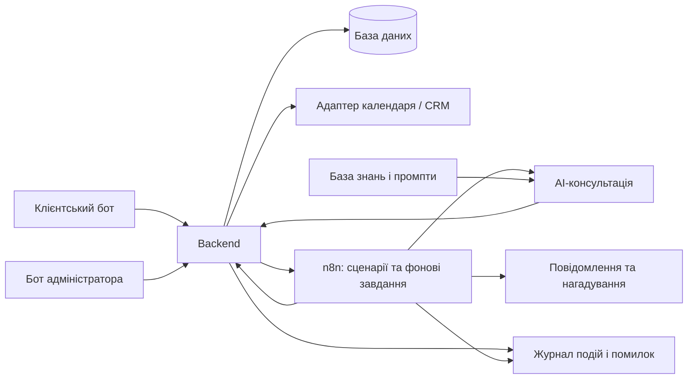

# Architecture — MVP 1

## Основа зі схеми
Клієнтський бот і бот адміністратора; backend; клієнтські та адміністративні сценарії n8n; черга завдань; AI-агент із базою знань та промптами; запис і повідомлення; база клієнтів та заявок; календар/CRM; статистика; логування й помилки.

## Пропонована схема відповідальності

Це уточнення вихідної схеми: команди зміни записів проходять через backend незалежно від того, чи надійшли вони з бота, AI або n8n.

| Компонент | Відповідальність |
|---|---|
| Боти | Діалог, кнопки, збір даних, показ результату |
| Backend | Авторизація, перевірка даних, правила запису, захист від повторів і конфліктів |
| База даних | Клієнти, заявки, стани записів, згода, налаштування, виконання завдань |
| Календар/CRM | Графіки, доступність і резервування через адаптер |
| n8n | Послідовності діалогів/інтеграцій, фонові дії, нагадування й повторні спроби |
| AI | Консультація, уточнення потреб, пропозиції; без самостійного підтвердження запису |
| База знань | Перевірені послуги, ціни, тривалість, спеціалізації та правила салону |
| Статистика й журнал | Базові підсумки, діагностика та повідомлення адміністратору |

## Узгодженість записів — пропозиція
Backend є єдиною точкою зміни запису. Джерело істини для зайнятості необхідно обрати після визначення CRM. Якщо CRM гарантує резервування, підтвердження видається після її успішної відповіді. Якщо ні, потрібна власна транзакційна модель зайнятості та процедура синхронізації; однієї попередньої перевірки слоту недостатньо.

Зберігати внутрішній ID, зовнішній ID, ключ повтору операції та статус синхронізації. Тайм-аут CRM означає невідомий результат: перевірити створення перед повтором. При перенесенні зберігати старий запис до гарантованої зміни або керованої компенсації.

## Фонове виконання — пропозиція
Повідомлення й нагадування виконуються після збереження події через надійний журнал відправлення. Черга зі схеми описує логічні стани: очікує, у роботі, виконано, помилка. Конкретний механізм черги й спосіб розгортання n8n ще не обрані.

## Доступ і експлуатація
Клієнт працює лише зі своїми записами. Адміністратор визначається перевіреним списком облікових записів. Секрети інтеграцій зберігаються поза документацією та промптами. Помилки мають ID операції; контакти й тексти діалогів не слід без потреби записувати в технічні логи.

## Ще не обрано
Мова backend, СУБД, канал ботів, CRM/календар, AI-провайдер, хостинг, резервне копіювання та конкретна черга. Згадка Telegram у блоці помилок SVG — підказка, але не достатнє підтвердження вибору каналу.

