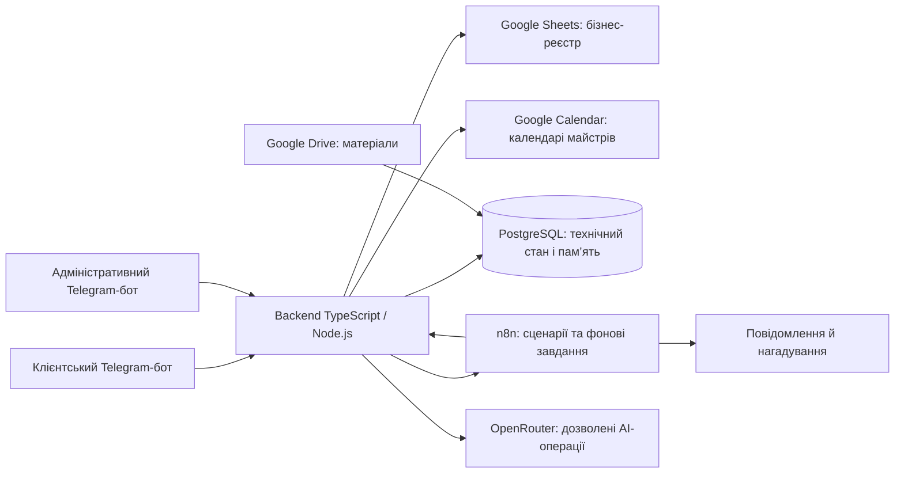

# Карта документації та проєкту

Оновлено 2026-10-12. Основна точка навігації; не передається клієнтській моделі.

## Де шукати
Документи згруповані за призначенням у [README](README.md), фізичні шляхи залишаються стабільними. Резервні projects/ та reflection/ не є частиною обов’язкового читання.
| Питання | Основне джерело |
|---|---|
| Що будуємо й для кого | [Vision](vision.md) |
| Які функції MVP і критерії | [Features](features.md) |
| Прайс, графік, утримання, згода, доступ | [Бізнес-правила](business-rules.md) |
| Компоненти й межі відповідальності | [Architecture](architecture.md) |
| Дані, стани й послідовності | [Data Flow](data-flow.md) |
| Моделі, reasoning, fallback, кошторис і ліміти | [Model Strategy](model-strategy.md) |
| Промпти, контекст, пам’ять, індекс, кеші, API, retries | [Context Strategy](context-strategy.md) |
| Локальне розгортання, копії, простій | [Експлуатація](operations.md) |
| Що робити й перевіряти | [Tasks](tasks.md) |
| Що ще потрібно вирішити | [Відкриті питання](open-questions.md) |
| Ризики | [Risks](risks.md) |
| Чому прийнято рішення | [Журнал рішень](decisions.md) |
| Що фактично зроблено | [Progress](progress.md) |
| Джерела й обмеження перевірки | [Research](research.md) |
| Незрозумілий термін | [Глосарій](glossary.md) |
| Вихідний скоуп | [SVG](drafts/inputs/salon-agent.svg) |
| Попередні версії | [Архів](archive/README.md) |
| Історія змін у Git і правила комітів | [Контроль версій](version-control.md) |

## Карта компонентів

Це схема запроєктованих відповідальностей, не готова реалізація. Вхід Telegram через backend long polling рекомендований, але окремо ще не погоджений. Матеріали Drive активуються адміністратором після перевірки.
Усі зміни записів — через backend. Sheets — остаточний бізнес-реєстр; PostgreSQL — технічний стан; Calendar — відображення. План переходу на Airtable не є поточним розгортанням.

## Як читати асистенту
Постійне правило: при кожній зміні проєкту чи документації перевіряти цю карту й [глосарій](glossary.md) та одразу актуалізувати за потреби. Правило закріплено в AGENTS.md і [system.md](system.md); пряма заборона запису має пріоритет.
1. AGENTS.md → system.md → activeContext.md.
2. За завданням вибрати потрібні документи цієї карти, не читати весь банк автоматично.
3. Погоджені факти брати з актуальних джерел; архів — лише для історії.
4. Реалізацію перевіряти за кодом/тестами, а не за чекбоксом погодження.
5. Секрети не зберігати тут і не включати у промпти.
6. Факт або число має одного власника: бізнес-правила, контекст або Model Strategy. Інші файли посилаються на нього.

## Маршрути читання
| Завдання | Достатній початковий набір |
|---|---|
| Зрозуміти продукт | vision.md → features.md → business-rules.md |
| Продовжити роботу | activeContext.md → tasks.md → open-questions.md |
| Реалізувати запис | architecture.md → data-flow.md → business-rules.md |
| Налаштувати AI | model-strategy.md → context-strategy.md |
| Запуск або відновлення | operations.md → architecture.md |
| Перевірити підставу рішення | decisions.md → потрібне актуальне джерело; архів лише за потреби |

Старі drafts-шляхи — покажчики сумісності з прямими посиланнями на актуальний документ та його архівну версію. Не вважати їх окремими специфікаціями.

## Статуси
Погоджено — користувач прийняв рішення. Рекомендовано — ще потрібне рішення. Припущення — розрахунковий орієнтир. Реалізовано — підтверджено кодом/перевіркою. Тестові дані — не реальний прайс чи особа.
